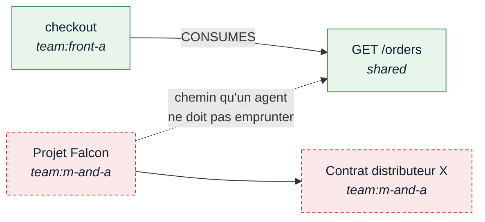
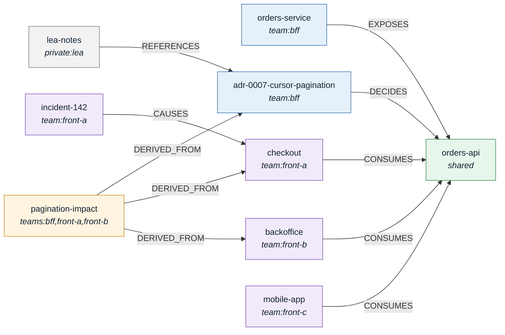
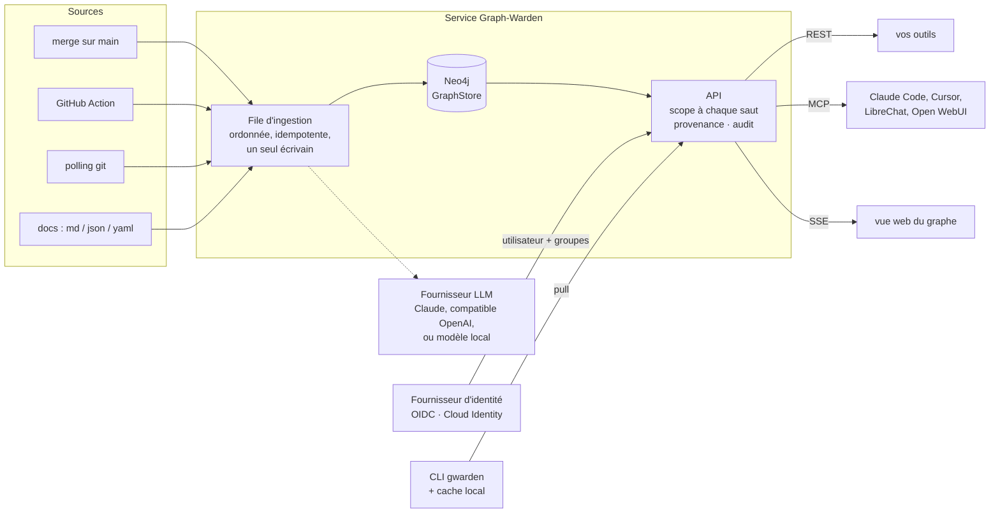
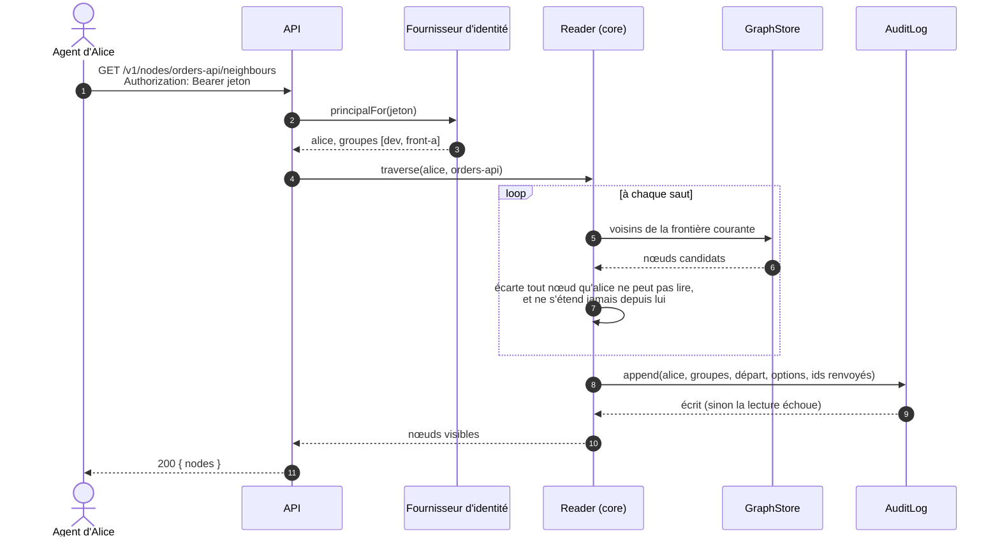
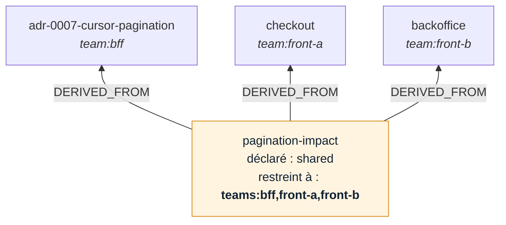
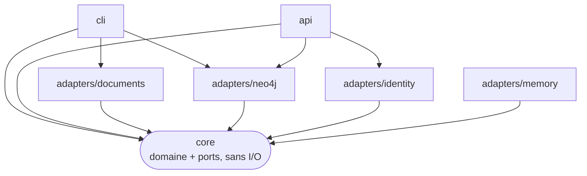

<p align="center">
  <picture>
    <source media="(prefers-color-scheme: dark)" srcset="docs/assets/banner-dark.png">
    
  </picture>
</p>

<p align="center"><a href="README.md">English</a> · <b>Français</b></p>

# Graph-Warden

**Un seul graphe de connaissance pour les agents IA de toutes les équipes, avec des droits vérifiés à chaque saut.**

Graph-Warden rassemble ce que les équipes écrivent déjà (dépôts, specs d'API, documentation, sessions d'agents), le relie en un graphe typé, et permet aux agents IA de l'interroger. Chaque requête est faite au nom d'une personne, ne renvoie que ce que cette personne a le droit de voir, et est enregistrée.

> Statut : **pré-alpha**, jalon M0. Rien n'est prêt pour la production. Voir [ce qui marche aujourd'hui](#ce-qui-marche-aujourdhui) et la [roadmap](docs/ROADMAP.md) (en anglais).
>
> La version anglaise ([README.md](README.md)) fait foi ; la documentation détaillée (`docs/`) est en anglais.

**Mode d'emploi.** La [première partie](#partie-1--le-produit) s'adresse à qui doit juger si l'outil est utile : le problème, pour qui, une démo. La [seconde partie](#partie-2--sous-le-capot) s'adresse à qui le construit ou l'exploite : architecture, contrôle d'une lecture, mise en route.

| Partie 1 — Le produit | Partie 2 — Sous le capot |
|---|---|
| [Le problème](#le-problème) | [Architecture](#architecture) |
| [Un exemple](#un-exemple--un-endpoint-quatre-équipes) | [Scopes](#scopes) |
| [Ce qu'il garantit](#ce-quil-garantit) | [Anatomie d'une lecture](#anatomie-dune-lecture) |
| [Pour qui](#pour-qui) | [Scopes dérivés](#scopes-dérivés) |
| [Le voir tourner](#le-voir-tourner) | [Démarrage rapide](#démarrage-rapide) |
| [Ce qui le distingue](#ce-qui-le-distingue) | [Organisation du dépôt](#organisation-du-dépôt) |
| [Ce qui marche aujourd'hui](#ce-qui-marche-aujourdhui) | [Contribuer](#contribuer) |

---

# Partie 1 — Le produit

## Le problème

Une grande organisation veut que ses agents IA sachent ce qu'elle sait. Aujourd'hui elle a deux options, mauvaises toutes les deux :

- **Tout ouvrir.** L'agent d'une équipe lit des dossiers RH, des incidents de sécurité, des notes de fusion-acquisition et des données clients qui ne la regardent pas.
- **Cloisonner chaque équipe.** Chacune a son silo, et tout ce qui traverse les équipes est perdu — précisément là où les agents seraient le plus utiles.

Graph-Warden est la troisième option : **un graphe partagé, avec un accès décidé à chaque lecture.**

Filtrer la réponse finale ne suffit pas. Dans un graphe, le chemin lui-même fait fuiter de l'information :



Un agent qui travaille pour un développeur front peut aller de `checkout` à `GET /orders`. Il ne doit pas continuer jusqu'au `Projet Falcon`, ni même apprendre qu'il existe parce qu'un chemin passait par lui. Graph-Warden vérifie les droits **avant chaque pas**, pas sur le résultat final.

## Un exemple : un endpoint, quatre équipes

L'équipe BFF s'apprête à changer la pagination de `GET /orders`. Trois équipes front le consomment.

- **Bob** (équipe BFF) demande à son agent ce qui dépend de l'endpoint. Il voit son service et sa décision d'architecture, pas les notes internes des équipes front.
- **Alice** (équipe front A) voit son module de paiement et l'incident qu'il a causé le mois dernier, pas l'intérieur du BFF.
- **Lea** (lead) voit tout, plus une synthèse d'impact rédigée pour les leads à partir des documents des trois équipes.
- **Bob ne voit pas cette synthèse**, bien qu'elle ait été publiée comme « partagée » : elle est construite à partir de documents qu'il n'a pas le droit de lire, donc Graph-Warden la restreint automatiquement.
- **Le DPO** peut lister chaque lecture faite par n'importe quel agent, et quand. Bob ne le peut pas.

Un graphe, cinq personnes, cinq vues correctes — et personne n'a configuré de filtre pour aucune d'elles. La [démo](#le-voir-tourner) joue exactement ce scénario.

## Ce qu'il garantit

| Garantie | En clair |
|---|---|
| **Accès vérifié à chaque pas** | Un agent ne passe jamais par ce que son utilisateur n'a pas le droit de voir, donc rien ne se déduit à travers. |
| **Une synthèse hérite de ses sources** | Une synthèse construite à partir des documents de trois équipes n'est lisible que par qui peut lire les trois. |
| **Privé par défaut** | Un document sans scope reste privé à qui l'a ajouté. Partager est toujours une décision. |
| **Une seule porte** | Agents et outils n'atteignent le graphe que par l'API. Personne n'interroge la base directement. |
| **Chaque lecture est enregistrée** | Qui a demandé, avec quels groupes, quoi, et ce qui est revenu. Si l'enregistrement échoue, la lecture échoue. |
| **Votre annuaire décide** | Utilisateurs et groupes viennent de votre fournisseur d'identité (Entra ID, Okta, Keycloak, Google Workspace…). Pas de seconde base d'utilisateurs à maintenir. |
| **L'effacement suit les synthèses** *(prévu)* | Supprimer une source supprime ou reconstruit tout ce qui en dérive (RGPD, article 17). |

## Pour qui

- **Équipes sécurité : des agents qui ne fuient pas.** Les droits sont vérifiés à chaque pas d'une traversée, pas seulement sur le résultat.
- **Équipes de développement : l'impact inter-équipes avant le merge.** Quand l'équipe BFF change un endpoint, les équipes front qui le consomment sont prévenues dans la pull request, avant que ça casse en production *(prévu, M2)*.
- **Protection des données et audit : la conformité intégrée.** Chaque lecture faite par un agent au nom d'un utilisateur est enregistrée, et l'effacement atteindra tout ce qu'un LLM a dérivé de la source effacée.
- **Équipes infrastructure : il tient dans les contraintes d'un grand groupe.**
  - Auto-hébergé, sur GCP, Azure ou on-premise.
  - Les postes développeurs n'ouvrent aucun port entrant : ils tirent la partie du graphe que leur utilisateur peut voir.
  - Pas de tunnel, et SSE plutôt que WebSocket, donc les proxys d'entreprise laissent passer.
  - Apache-2.0, que les juristes acceptent là où ils bloquent souvent l'AGPL.
  - N'importe quel modèle, y compris un modèle local pour les sources sensibles.

## Le voir tourner

La démo est l'exemple ci-dessus, sur une boutique fictive. Son graphe :



| Personne | Groupes (fournis par l'annuaire) |
|---|---|
| Bob | `dev`, `bff` |
| Alice | `dev`, `front-a` |
| Carla | `dev`, `front-c` |
| Lea | `dev`, `dev-leads`, et à travers lui tous les groupes d'équipe |
| DPO | `auditors` |

Il ne faut que Docker :

```sh
docker compose --profile demo up -d --build --wait
examples/shop/demo.sh
```

**1. Même question, même graphe, quatre réponses.** Bob voit le côté BFF de l'endpoint, Alice son module et son incident, Carla seulement l'application mobile. Lea, lead, voit tout autour, y compris ses propres notes privées.

<p align="center"></p>

**2. Une synthèse prend le scope de toutes ses sources.** Bob est dans `bff` mais ni dans `front-a` ni dans `front-b` : pour lui, la synthèse d'impact n'existe pas. Lea la lit, ainsi que ses sources.

<p align="center"></p>

**3. Tirer dans un cache local.** Le poste d'Alice n'ouvre aucun port : il tire un cache SQLite qui ne contient que ce qu'elle peut voir, puis seulement les changements.

<p align="center"></p>

**4. Chaque lecture est enregistrée.** Bob n'a pas le droit de lire le journal d'audit, et sa tentative est elle-même enregistrée. Le DPO, si.

<p align="center"></p>

L'API de démo utilise des jetons fixes (`examples/shop/users.yaml`) et n'écoute que sur localhost. Pour l'arrêter : `docker compose --profile demo down`.

## Ce qui le distingue

Les bases de graphe ont déjà un contrôle d'accès par rôle, et les bibliothèques de mémoire d'agent cloisonnent déjà les souvenirs par utilisateur. Ce qu'elles laissent ouvert, c'est ce qui se passe entre l'agent et la connaissance :

- des chemins qui fuient à travers des nœuds que le lecteur ne devrait pas voir ;
- des synthèses écrites par un LLM plus visibles que leurs sources ;
- un effacement qui s'arrête au document d'origine ;
- des changements dans une équipe qui en cassent une autre sans prévenir.

## Ce qui marche aujourd'hui

- l'ontologie typée (Zod) et un stockage de graphe Neo4j ;
- l'ingestion de documents Markdown, JSON et YAML avec références typées, privés par défaut ;
- la traversée avec scopes vérifiés à chaque saut ; les documents dérivés lisibles seulement par qui lit toutes leurs sources ;
- une API REST dont identités et groupes viennent d'un fournisseur OIDC ou de Google avec Cloud Identity ;
- une entrée d'audit pour chaque lecture ;
- `gwarden pull` vers un cache SQLite local qui ne contient que ce que l'utilisateur peut voir ;
- une démo `docker compose` et un déploiement Cloud Run.

**Pas encore :** la revalidation des scopes dérivés quand une source ou un groupe change, l'effacement, MCP, le flux SSE en direct, la compilation par LLM et la vue web. La conception est arrêtée dans [`docs/proposals`](docs/proposals) ; le travail est suivi dans les [issues](https://github.com/Graph-Warden/graph-warden/issues).

---

# Partie 2 — Sous le capot

## Architecture



Aujourd'hui : l'ingestion de documents par le CLI, Neo4j, l'API REST, les fournisseurs d'identité et `gwarden pull`. Prévu : la file, la compilation par LLM, les webhooks, MCP et SSE.

- **Le graphe est la source de vérité**, jamais les fichiers dont il est construit. Il vit sur un serveur : Neo4j en local (`pnpm db:up`) ou un déploiement hébergé, d'où `gwarden pull` ne récupère que ce que l'utilisateur peut voir.
- **Un seul écrivain, ingestion ordonnée** *(conception)* : seul le merge sur `main` écrit les nœuds partagés, dans l'ordre des commits, et rejouer un webhook ne crée aucun doublon ([proposal 0004](docs/proposals/0004-single-writer-ordered-ingestion.md)).
- **Ingestion ciblée**, comme `jest --findRelatedTests` : un merge ne revalide que la connaissance atteignable depuis les fichiers modifiés ([proposal 0005](docs/proposals/0005-targeted-ingestion.md)).
- **Aucun port entrant sur les postes développeurs** : les clients tirent ou s'abonnent en SSE ([proposal 0006](docs/proposals/0006-pull-and-sse.md)).
- **Votre modèle, votre client** : une interface `LLMProvider`, n'importe quel client MCP ([proposal 0007](docs/proposals/0007-pluggable-llm-and-clients.md)).

## Scopes

Chaque nœud porte exactement un scope :

| Scope | Lisible par |
|---|---|
| `shared` | toute personne authentifiée |
| `team:bff` | les membres du groupe `bff` |
| `teams:bff,front-a` | les membres des **deux** groupes (typiquement un nœud dérivé des deux équipes) |
| `private:alice` | Alice seulement |

Les groupes viennent du fournisseur d'identité, groupes imbriqués résolus. La supervision se décide là-bas, pas dans Graph-Warden : un groupe `dev-leads` imbriqué dans chaque groupe d'équipe permet aux leads de lire à travers les équipes. Voir la [proposal 0002](docs/proposals/0002-one-graph-many-scopes.md) et la [proposal 0010](docs/proposals/0010-identity-groups-and-derived-scopes.md).

## Anatomie d'une lecture



L'API est le seul endroit où les lecteurs atteignent le graphe ([proposal 0003](docs/proposals/0003-api-as-sole-enforcement-point.md)). L'entrée d'audit est écrite **avant** que la réponse parte ; les entrées sont en ajout seul, numérotées dans l'ordre d'écriture, et stockées hors du graphe que parcourent les traversées. Un test par propriétés (fast-check) le vérifie sur des graphes aléatoires : une traversée ne renvoie que des nœuds lisibles, et son résultat est inchangé quand on retire tous les nœuds que le lecteur ne peut pas voir — un nœud caché ne peut donc fuiter ni par un id, ni par un compte, ni par un chemin.

## Scopes dérivés



Un nœud avec des arêtes `DERIVED_FROM` prend le scope de toutes ses sources réunies, son scope déclaré comptant comme une source de plus : la dérivation ne l'élargit donc jamais.

- les sources `shared` n'ajoutent aucune restriction ;
- les sources d'équipe s'additionnent : `team:bff` + `team:front-a` donne `teams:bff,front-a` ;
- une seule source privée rend le résultat privé à son auteur.

L'auteur doit pouvoir lire chaque source : personne ne dérive de ce qu'il ne peut pas voir.

## Démarrage rapide

```sh
corepack enable
pnpm install
pnpm typecheck && pnpm lint && pnpm test
```

Les tests de l'adaptateur Neo4j tournent quand `NEO4J_TEST_URI` pointe vers une base jetable, qu'ils vident :

```sh
docker compose --profile test up -d --wait neo4j-test
NEO4J_TEST_URI=bolt://localhost:7688 pnpm test
```

### Ingérer et interroger en local

Ingérer un dossier de documents Markdown, JSON ou YAML dans le Neo4j local, puis parcourir le graphe sous différentes identités :

```sh
cp .env.example .env
pnpm db:up && pnpm build
pnpm gwarden ingest ~/docs --source docs:my-team --user alice --where theme=dev --default-scope team:dev
pnpm gwarden traverse some-page --user carol --team dev --direction both   # voit les pages de l'équipe
pnpm gwarden traverse some-page --user bob --direction both                # ne voit rien
pnpm gwarden audit --user carol                                            # ce que carol a lu, et quand

pnpm gwarden ingest ~/notes --source docs:alice --user alice       # aucun scope : privé à alice
```

Un document est une page Markdown avec frontmatter, ou un objet JSON ou YAML :

```markdown
---
type: Module
scope: team:front-a
references:
  - { type: CONSUMES, to: orders-api }
---
# Checkout

Liste les commandes du client avec `GET /orders`, page par page.
```

- `references` liste les arêtes, typées (`{ type: DECIDES, to: bff-api }`) ou non (`- glossary`, une arête `REFERENCES`, comme un lien Markdown `[[glossary]]`).
- `id` vaut par défaut le nom du fichier, `type` vaut `Concept`.
- `scope` (`shared`, `team:<x>`, `teams:<x>,<y>`, `private:<user>`) l'emporte sur `--default-scope`. Sans l'un ni l'autre, un document est privé à l'`--user` qui l'ingère.
- `--where clé=valeur` garde les documents dont le champ vaut la valeur ou, pour une liste, la contient.
- `--team` tient lieu des groupes que fournira un fournisseur d'identité. Via l'API, les groupes viennent du jeton.

Neo4j Browser sur <http://localhost:7474> (utilisateur `neo4j`, mot de passe dans `.env`) montre le graphe brut, par exemple `MATCH p=(:Node)-[:REFERENCES]->(:Node) RETURN p`. C'est une vue d'administrateur : elle contourne les scopes, que seuls `gwarden` et l'API appliquent.

### Via l'API

Les lecteurs passent par l'API, pas par Neo4j : `pnpm --filter @graph-warden/api start` avec les réglages de [`packages/api/src/config.ts`](packages/api/src/config.ts), puis `gwarden traverse`, `pull`, `cache` et `audit` avec `--api` et `--token` (ou `GWARDEN_API` et `GWARDEN_TOKEN`). L'API se documente elle-même sur `/openapi.json`.

| Route | Renvoie |
|---|---|
| `GET /v1/me` | l'utilisateur et les groupes de l'appelant |
| `GET /v1/nodes/{id}/neighbours` | les nœuds atteignables depuis `id` que l'appelant peut lire (`direction`, `depth`, `edge`) |
| `GET /v1/pull?after=<curseur>` | ce qui a changé pour l'appelant depuis le curseur |
| `GET /v1/audit` | le journal d'audit, pour les groupes auditeurs seulement |

### Déployer sur Google Cloud

[`deploy/gcp`](deploy/gcp/README.md) (en anglais) : l'API sur Cloud Run, le graphe sur Neo4j Aura, les identités via la connexion Google restreinte à votre domaine, les groupes via Cloud Identity.

## Organisation du dépôt

| Package | Rôle | État |
|---|---|---|
| `packages/core` | Ontologie, scopes, scopes dérivés, traversée vérifiée à chaque saut, lectures auditées, journal d'événements et deltas de pull ; ports `GraphStore`, `AuditLog`, `EventLog` et `IdentityProvider` | M0 fait, M2 en cours |
| `packages/adapters/neo4j` | `GraphStore`, `AuditLog` et `EventLog` en ajout seul sur Neo4j | fait |
| `packages/adapters/identity` | `IdentityProvider` pour OIDC (Entra ID, Keycloak, Okta…), Google avec les groupes Cloud Identity, et jetons de démo | M2, première tranche |
| `packages/adapters/memory` | Ports en mémoire pour les tests et les démos | fait |
| `packages/adapters/documents` | Documents Markdown, JSON et YAML en nœuds et arêtes typées | M1, première tranche |
| `packages/cli` | `gwarden ingest`, `traverse`, `audit`, `pull`, `cache` ; plus tard `forget`, impact de PR | M0–M2 |
| `packages/api` | REST avec OpenAPI, seul point d'accès des lecteurs au graphe ; webhooks plus tard | M2, première tranche |
| `packages/mcp` | Serveur MCP | M2, prévu |
| `packages/worker` | Consommateur de la file d'ingestion, appels LLM | M1, prévu |
| `packages/web` | Vue du graphe (Sigma.js), en direct via SSE | M2, prévu |
| `packages/adapters/*` | Autres sources, fournisseurs LLM, stockages, files, analyseurs | M1+ |



Le core porte les règles et définit les ports ; les adaptateurs les implémentent ([proposal 0009](docs/proposals/0009-domain-driven-design.md)). Un nouveau stockage, une nouvelle source ou un nouveau fournisseur d'identité est un adaptateur, jamais un changement des règles. Le vocabulaire est dans le [glossaire](docs/glossary.md) (en anglais).

## Contribuer

Les adaptateurs sont la porte d'entrée la plus simple : chaque type a une interface typée dans `core` (une suite de conformité partagée par type est prévue). Lisez [CONTRIBUTING.md](CONTRIBUTING.md), puis choisissez une issue étiquetée [`good first issue`](https://github.com/Graph-Warden/graph-warden/labels/good%20first%20issue). Les commits suivent Conventional Commits et sont signés (`git commit -s`).

Vous avez trouvé un moyen de lire ce que vous ne devriez pas ? Signalez-le en privé : voir [SECURITY.md](SECURITY.md).

## Licence

[Apache-2.0](LICENSE)
