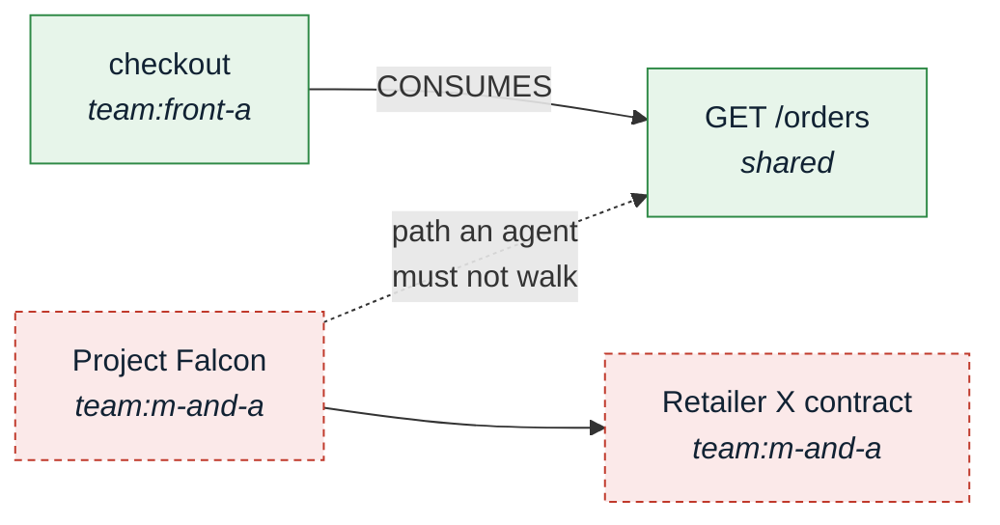
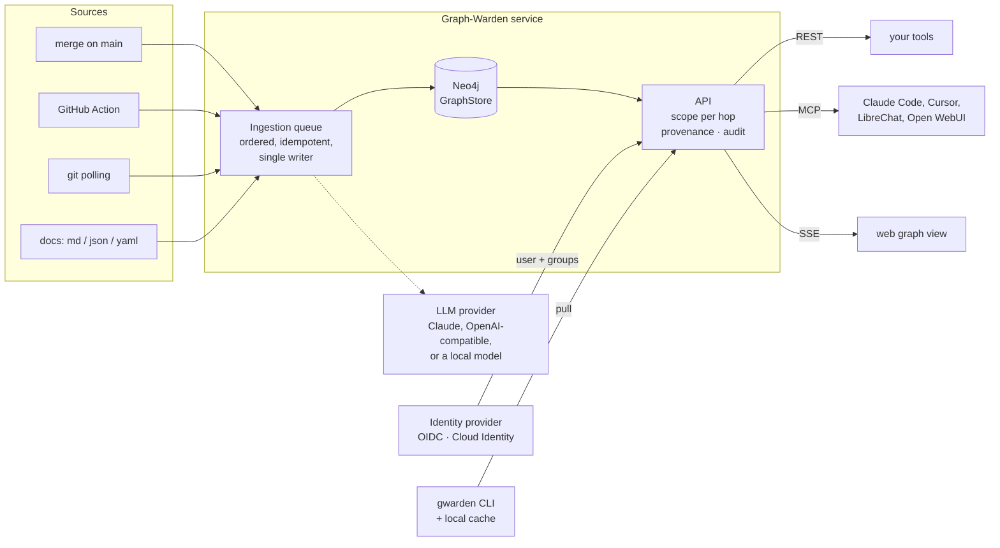
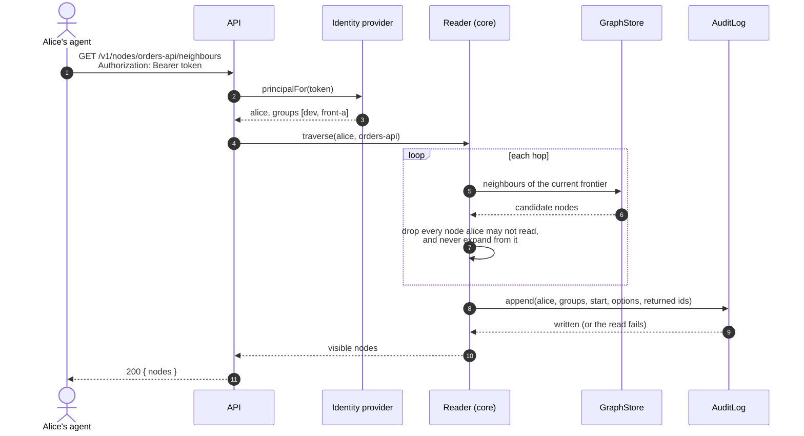
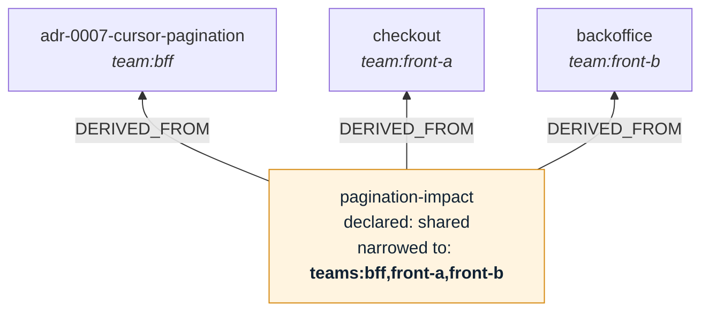
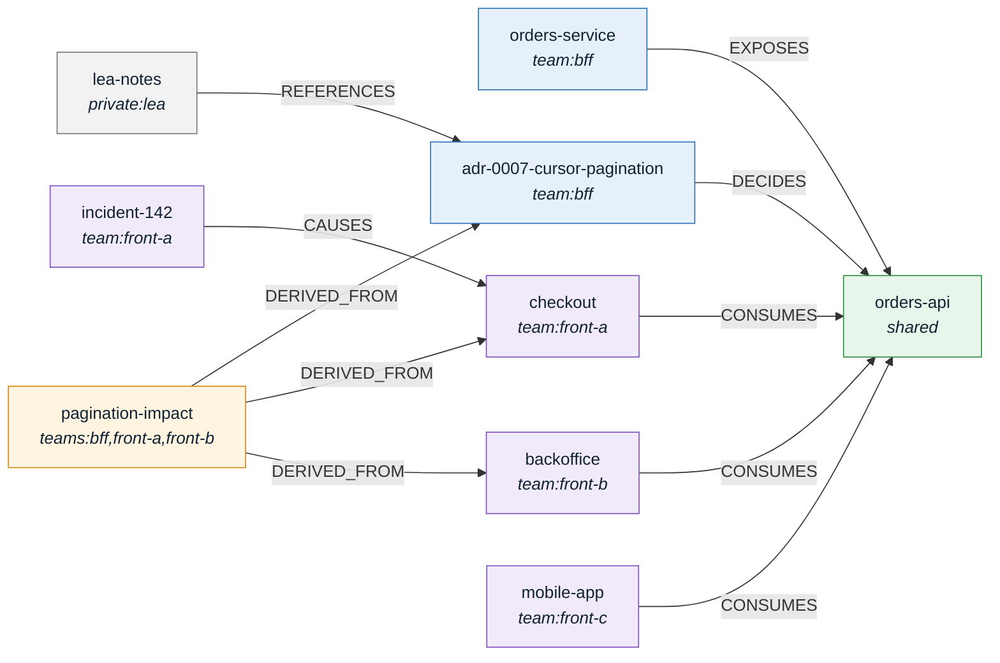
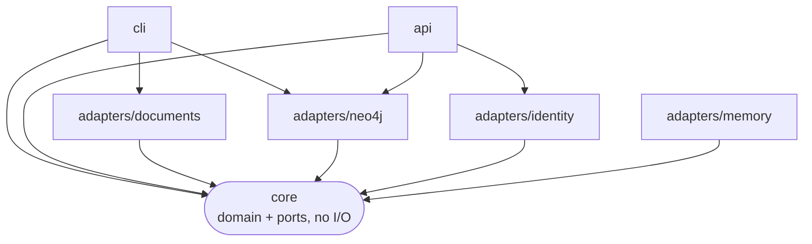

<p align="center">
  <picture>
    <source media="(prefers-color-scheme: dark)" srcset="docs/assets/banner-dark.png">
    
  </picture>
</p>

# Graph-Warden

**One knowledge graph for every team's AI agents, with rights checked on every hop.**

Graph-Warden captures knowledge where teams already produce it (repositories, API specs, docs, agent sessions), compiles it into a typed graph, and serves it to any consumer over REST, MCP or a live event stream. Every read is made on behalf of a person, sees only what that person's groups allow, and is recorded.

> Status: **pre-alpha**, milestone M0. Nothing here is ready for production. The design is settled in [`docs/proposals`](docs/proposals); the work is tracked in [issues](https://github.com/Graph-Warden/graph-warden/issues) and the [roadmap](docs/ROADMAP.md). See [what works today](#what-works-today).

## The problem in one picture

A large organisation wants its AI agents to know what the organisation knows. It has two options today, and both are bad:

- **Open everything.** One team's agent reads HR files, security incidents, M&A notes and customer data that are none of its business.
- **Wall every team off.** Each team gets its own silo, and everything that crosses teams is lost, which is exactly what agents are most useful for.

Graph-Warden is the third option: one graph, with access decided on every read. Filtering the result is not enough, because the path itself leaks:



An agent working for a front-end developer may walk from `checkout` to `GET /orders`. It may not walk on to `Project Falcon`, and it must not learn that the node exists because a path ran through it. Graph-Warden checks the reader's scopes **before each hop**, not on the final result.

## What it guarantees

| Guarantee | What it means | Where it lives |
|---|---|---|
| **Per-hop access** | A traversal never crosses a node the reader may not see, so nothing is inferred through it. | `packages/core` reader, [proposal 0002](docs/proposals/0002-one-graph-many-scopes.md) |
| **Derived knowledge inherits its sources** | A summary compiled from three teams' documents is readable only by people who may read all three. | `deriveScopes`, [proposal 0010](docs/proposals/0010-identity-groups-and-derived-scopes.md) |
| **Private by default** | A document with no scope is private to whoever ingested it. Nothing is shared unless someone chose to. | CLI `ingest` |
| **One enforcement point** | Readers reach the graph only through the API. No client talks to Neo4j. | `packages/api`, [proposal 0003](docs/proposals/0003-api-as-sole-enforcement-point.md) |
| **Every read is audited** | Who asked, with which groups, from which node, and which ids came back. If the entry cannot be written, the read fails. | `AuditLog` port |
| **Identities come from your directory** | Users and groups come from OIDC (Entra ID, Keycloak, Okta…) or Google with Cloud Identity. Graph-Warden never manages accounts. | `packages/adapters/identity` |
| **Erasure follows derivation** *(planned)* | Deleting a source deletes or recompiles everything derived from it (GDPR article 17). | M1 |

### Scopes

Every node carries exactly one scope:

| Scope | Readable by |
|---|---|
| `shared` | everyone authenticated |
| `team:bff` | members of the `bff` group |
| `teams:bff,front-a` | members of **both** groups (a derived node with sources from both teams) |
| `private:alice` | Alice only |

Oversight belongs to the directory, not to Graph-Warden: a `dev-leads` group nested in every team group lets leads read across teams, and that is decided where the groups are managed.

## How it works



Today: document ingestion through the CLI, Neo4j, the REST API, identity providers and `gwarden pull`. Planned: the queue, LLM compilation, webhooks, MCP and SSE (see the [roadmap](docs/ROADMAP.md)).

- **The graph is the source of truth**, never the files it was built from. It lives in a server: Neo4j locally (`pnpm db:up`) or a hosted deployment, from which `gwarden pull` fetches only what the user may see.
- **Targeted ingestion**, like `jest --findRelatedTests`: a merge only revalidates the knowledge reachable from the files it changed.
- **No inbound port on developer machines**: clients pull or subscribe over SSE, so it works behind corporate proxies without tunnels.
- **Bring your own model and your own client**: one `LLMProvider` interface, any MCP client.

### Anatomy of a read



The audit entry is written **before** the answer leaves. Entries are append-only, numbered in write order, and stored outside the graph that traversals walk.

### Derived scopes



The leads wrote an impact summary and declared it `shared`. It is built from three teams' documents, so ingestion narrows it to the readers of all three. Declaring a scope can only make a node more private than its sources allow, never less. The ingesting user must be able to read every source.

## See it run

The demo is a sample shop where the BFF team is about to change the pagination of `GET /orders`, consumed by three front-end teams.



| Person | Groups (from the directory) |
|---|---|
| Bob | `dev`, `bff` |
| Alice | `dev`, `front-a` |
| Carla | `dev`, `front-c` |
| Lea | `dev`, `dev-leads`, and through it every team group |
| DPO | `auditors` |

```sh
docker compose --profile demo up -d --build --wait
examples/shop/demo.sh
```

**1. Same question, same graph, four answers.** Bob sees the BFF side of the endpoint, Alice her module and its incident, Carla only the mobile app. Lea, a lead, sees everything around it, including her own private notes.

<p align="center"></p>

**2. A derived summary takes the scope of all its sources.** Bob is in `bff` but not in `front-a` or `front-b`, so the impact summary does not exist for him. Lea reads it and its sources.

<p align="center"></p>

**3. Pull into a local cache.** Alice's machine opens no port: it pulls a SQLite cache that holds only what she may see, and later pulls only the changes.

<p align="center"></p>

**4. Every read is audited.** Bob may not read the audit log, and his attempt is itself recorded. The DPO may.

<p align="center"></p>

The API uses fixed demo tokens (`examples/shop/users.yaml`) and listens on localhost only. Stop it with `docker compose --profile demo down`.

## Who it is for

- **Security teams: agents that do not leak.** Rights are checked on every hop of a traversal, not only on the result.
- **Engineering teams: cross-team impact before the merge.** When the BFF team changes an endpoint, the front-end teams that consume it are told in the pull request, before it breaks in production *(planned, M2)*.
- **Data protection and audit: compliance built in.** Every read an agent makes on behalf of a user is recorded, and an erasure request will also reach everything an LLM derived from the erased source.
- **Infrastructure teams: it fits a large group's constraints.**
  - Self-hosted, on GCP, Azure or on premises.
  - Developer machines open no inbound port: they pull the part of the graph their user may see.
  - No tunnel, and SSE rather than WebSocket, so corporate proxies let it through.
  - Apache-2.0, which legal teams accept where they often block the AGPL.
  - Any model, including a local one for sensitive sources.

### How it differs

Graph databases already have role-based access, and agent-memory libraries already scope memories by user. What they leave open is what happens between the agent and the knowledge: paths that leak through hidden nodes, LLM-derived knowledge that outlives or outranks its sources, erasure that stops at the original document, and changes in one team that silently break another.

## What works today

- the typed ontology (Zod) and a Neo4j graph store;
- ingestion of Markdown, JSON and YAML documents with typed references, private by default;
- traversal with scopes checked on every hop; derived documents readable only by those who read all their sources;
- a REST API whose identities and groups come from an OIDC provider or Google with Cloud Identity;
- an audit entry for every read;
- `gwarden pull` into a local SQLite cache holding only what the user may see;
- a `docker compose` demo and a Cloud Run deployment.

**Not yet:** revalidating derived scopes when a source or a group changes, erasure, MCP, the live SSE stream, LLM compilation and the web view.

## Repository layout

| Package | Role | State |
|---|---|---|
| `packages/core` | Ontology, scopes, derived scopes, per-hop traversal, audited reads, event log and pull deltas; `GraphStore`, `AuditLog`, `EventLog` and `IdentityProvider` ports | M0 done, M2 in progress |
| `packages/adapters/neo4j` | `GraphStore`, append-only `AuditLog` and `EventLog` on Neo4j | done |
| `packages/adapters/identity` | `IdentityProvider` for OIDC (Entra ID, Keycloak, Okta…), Google with Cloud Identity groups, and demo tokens | M2, first slice |
| `packages/adapters/memory` | In-memory ports for tests and demos | done |
| `packages/adapters/documents` | Markdown, JSON and YAML documents as nodes and typed edges | M1, first slice |
| `packages/cli` | `gwarden ingest`, `traverse`, `audit`, `pull`, `cache`; later `forget`, PR impact | M0–M2 |
| `packages/api` | REST with OpenAPI, the only place readers reach the graph; webhooks later | M2, first slice |
| `packages/mcp` | MCP server | M2, planned |
| `packages/worker` | Ingestion queue consumer, LLM calls | M1, planned |
| `packages/web` | Graph view (Sigma.js), live over SSE | M2, planned |
| `packages/adapters/*` | More sources, LLM providers, stores, queues, analyzers | M1+ |



The core holds the rules and defines ports; adapters implement them ([proposal 0009](docs/proposals/0009-domain-driven-design.md)). A new store, source or identity provider is an adapter, never a change to the rules.

## Development

```sh
corepack enable
pnpm install
pnpm typecheck && pnpm lint && pnpm test
```

The Neo4j adapter tests run when `NEO4J_TEST_URI` points at a throwaway database, which they wipe:

```sh
docker compose --profile test up -d --wait neo4j-test
NEO4J_TEST_URI=bolt://localhost:7688 pnpm test
```

### Deploy on Google Cloud

[`deploy/gcp`](deploy/gcp/README.md): the API on Cloud Run, the graph on Neo4j Aura, identities from Google sign-in restricted to your domain, groups from Cloud Identity.

### Run it locally

Ingest a folder of Markdown, JSON or YAML documents into the local Neo4j, then walk the graph as different principals:

```sh
cp .env.example .env
pnpm db:up && pnpm build
pnpm gwarden ingest ~/docs --source docs:my-team --user alice --where theme=dev --default-scope team:dev
pnpm gwarden traverse some-page --user carol --team dev --direction both   # sees the team's pages
pnpm gwarden traverse some-page --user bob --direction both                # sees nothing
pnpm gwarden audit --user carol                                            # what carol read, and when

pnpm gwarden ingest ~/notes --source docs:alice --user alice       # no scope given: private to alice
```

A document's fields are the frontmatter of a Markdown page, or the whole object of a JSON or YAML file. `references` lists its edges, typed or not: `- { type: DECIDES, to: bff-api }` or `- glossary` (a `REFERENCES` edge, like a Markdown `[[glossary]]` link). `id` defaults to the file name, `type` to `Concept`.

```markdown
---
type: Module
scope: team:front-a
references:
  - { type: CONSUMES, to: orders-api }
---
# Checkout

Lists the customer's orders with `GET /orders`, page by page.
```

`--where key=value` keeps documents whose field equals the value or, for a list, contains it. A document's own `scope` field (`shared`, `team:<x>`, `teams:<x>,<y>`, `private:<user>`) wins over `--default-scope`. Without either, a document is private to the ingesting `--user`.

`--team` stands for the groups an identity provider (LDAP, OIDC, Cloud Identity) will report. Through the API, groups come from the token and `--team` is not used.

Neo4j Browser at <http://localhost:7474> (user `neo4j`, password from `.env`) shows the raw graph, for example `MATCH p=(:Node)-[:REFERENCES]->(:Node) RETURN p`. It is an administrator's view: it bypasses the scopes, which only `gwarden` and the API apply.

Readers go through the API rather than Neo4j: `pnpm --filter @graph-warden/api start` with the settings of [`packages/api/src/config.ts`](packages/api/src/config.ts), then `gwarden traverse`, `pull`, `cache` and `audit` with `--api` and `--token` (or `GWARDEN_API` and `GWARDEN_TOKEN`). The API documents itself at `/openapi.json`.

## Contributing

Adapters are the easiest way in: each kind has a typed interface in `core` (a shared conformance suite per kind is planned). Read [CONTRIBUTING.md](CONTRIBUTING.md), then pick an issue labelled [`good first issue`](https://github.com/Graph-Warden/graph-warden/labels/good%20first%20issue).

Found a way to read something you should not? Report it privately: see [SECURITY.md](SECURITY.md).

## License

[Apache-2.0](LICENSE)
